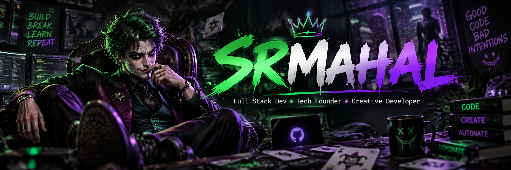

  

## 🃏 Sobre mim

<table>
<tr>
<td width="62%" valign="top">

<pre><code class="language-javascript">const srMahal = {
  nome: "Marcelo Halker",
  usuario: "SrMahal",

  atuacao: [
    "Full Stack Dev",
    "Tech Founder",
    "Creative Developer"
  ],

  construindo: [
    "Threeebs",
    "Studio Mahal",
    "Sonhar AI"
  ],

  stack: [
    "JavaScript",
    "HTML",
    "CSS",
    "PHP",
    "Python",
    "MySQL",
    "Docker",
    "Linux"
  ],

  filosofia: "Não faço força bruta, faço força lógica."
};
</code></pre>

</td>
<td width="38%" align="center" valign="top">

</td>
</tr>
</table>

## Detalhes
<h1 align="center">
    
</h1>

VPS, Docker e automações. 
Não faço força bruta, faço força lógica. 
Porta aberta não é invasão, é convite mal configurado. 
White hat, mas sem bater palma.

Full Stack Dev · Tech Founder 
Criando @sonharai, @studiomahal e @um_seguidor_um_ponto enquanto  
o mundo discute se Windows 12 finalmente vai respeitar o terminal.

### :hammer_and_wrench: Languages and Tools :
 
